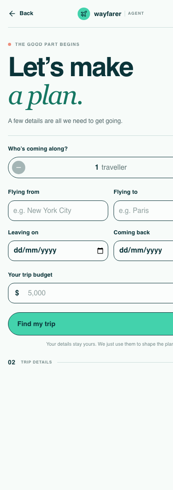
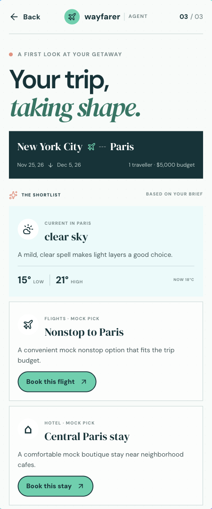

# Wayfarer Agent

A responsive React and TypeScript travel planner. Add a trip brief to get destination weather, one AI-generated mock flight option, and one AI-generated mock hotel option.

## Mobile Screens

| Welcome | Trip details | Recommendations |
| --- | --- | --- |
|  |  |  |

## Agent Capabilities

- Collects origin, destination, dates, traveller count, and budget.
- Uses OpenRouter with the OpenAI-compatible SDK to produce a concise trip plan.
- Calls the weather provider only for the entered destination; weather facts are not invented by the model.
- Produces one mock flight and one mock hotel suggestion. These are not live listings or bookings.
- Book buttons show a demo confirmation, then return home after five seconds. No payment or reservation is made.

## Run Locally

```sh
npm install
cp .env.example .env
```

Add your OpenRouter key to `OPENROUTER_API_KEY` in the root `.env`, then run:

```sh
npm run dev
```

The command starts the Vite frontend and local API server. The OpenRouter key stays on the server and must never be added to client code or committed. The weather endpoint can be changed with `WEATHER_API_URL`.

Run checks with:

```sh
npm run build
npm run lint
```

## Project Structure

- `src/App.tsx`: screen navigation and trip state.
- `src/features/trip-planner/`: screens, shared types, and API client.
- `server/`: OpenRouter orchestration and destination weather adapter.